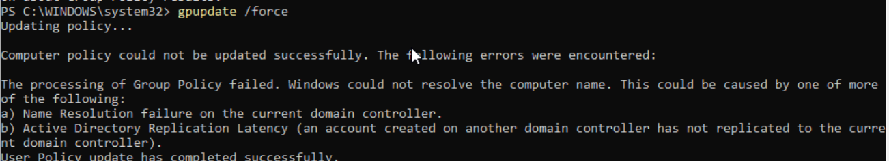
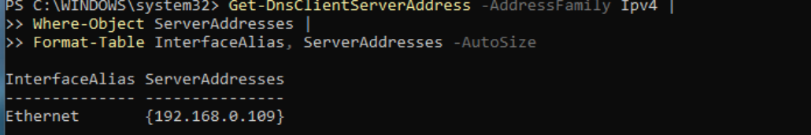
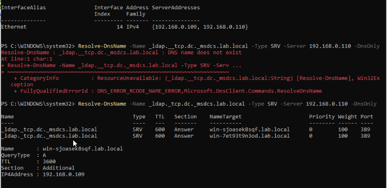
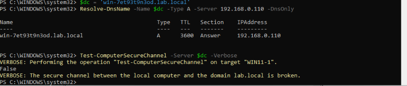
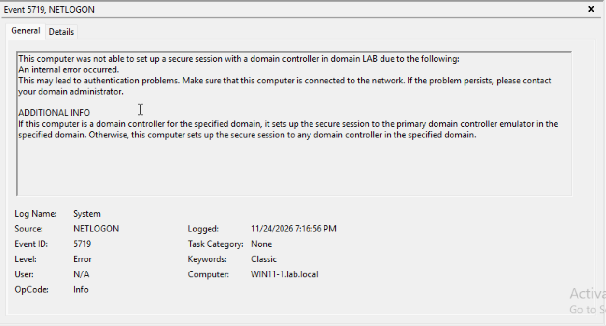
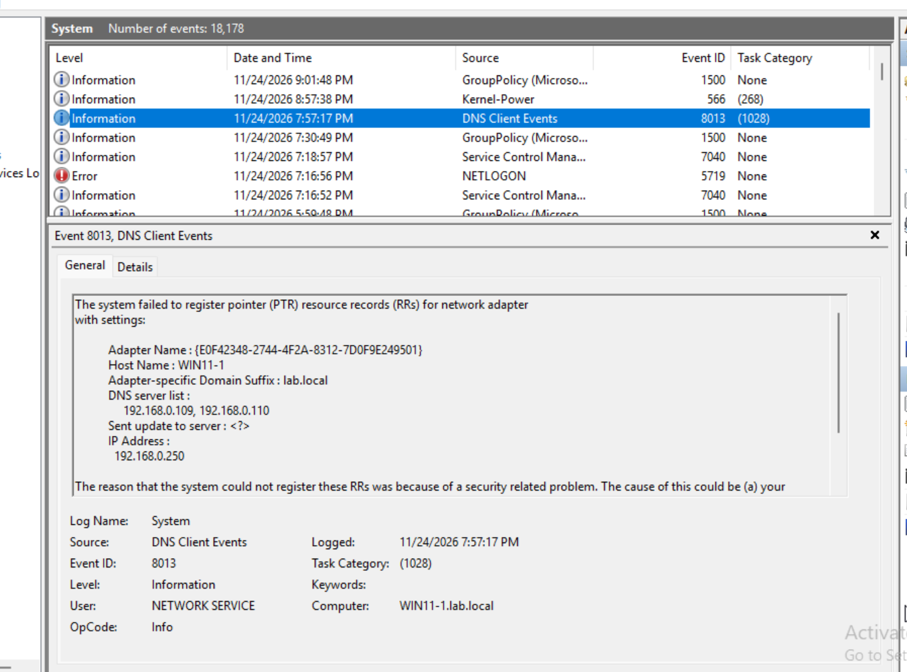
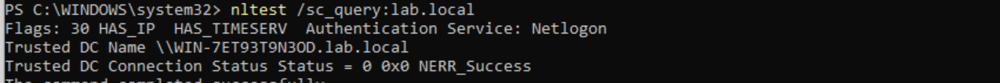
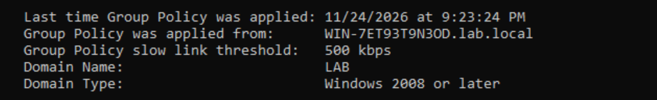

# Can Windows still apply Group Policy with one domain controller offline?

**Result: pass.** In my Proxmox homelab, I shut down the DC-3 virtual machine and verified that WIN11-1 could refresh **computer** Group Policy using DC-4. After I brought DC-3 back online, the replication check passed. My first attempt had failed, so the useful part of this drill was figuring out what each diagnostic actually proved.

This was a **single-DC outage**, not a complete site or Proxmox host outage. DC-4 was already a domain controller: it served the client without taking over DC-3’s PDC Emulator role.

## Lab setup

| System | Address | Role in the drill |
| --- | --- | --- |
| DC-3 · `WIN-SJOASEK8SQF.lab.local` | `192.168.0.109` | Domain controller, DNS server, and PDC Emulator. This was the VM I shut down. |
| DC-4 · `WIN-7ET93T9N3OD.lab.local` | `192.168.0.110` | Domain controller and DNS server that remained online. |
| WIN11-1 · `WIN11-1.lab.local` | `192.168.0.250` | Domain-joined Windows 11 VM where I tested policy. |

The names and private IPs below belong to my lab. If you repeat the drill, substitute your own. Use a maintenance window, verify that the surviving DC is healthy, and retain console access so you can start the stopped VM again. Don’t shut down the hypervisor.

## 1. Reproduce the symptom

On WIN11-1, I ran:

```powershell
gpupdate /force
```

**User policy succeeded; computer policy failed.** Windows said it couldn’t resolve the computer name and suggested name resolution or replication latency. Those were possible causes, not a diagnosis. I focused the remaining tests on the computer rather than treating the whole domain as unavailable.



## 2. Separate DNS configuration from DNS discovery

An early Ethernet check showed only `.109`. Later, I confirmed that WIN11-1 listed **both** internal DNS servers. The early screenshot doesn’t identify the machine, so I didn’t treat the two screenshots as proof that one settings change fixed the failure.

```powershell
Get-DnsClientServerAddress -AddressFamily IPv4 |
    Where-Object ServerAddresses |
    Format-Table InterfaceAlias, ServerAddresses -AutoSize
```



From WIN11-1, I asked DC-4 directly for the records clients use to find domain controllers:

```powershell
Resolve-DnsName -Name '_ldap._tcp.dc._msdcs.lab.local' -Type SRV -Server 192.168.0.110 -DnsOnly
```

My first query had a typo and returned **DNS name does not exist**. Correcting the query returned both controllers on LDAP port 389. Because I specified `-Server 192.168.0.110`, I knew **DC-4 answered**; the additional address for DC-3 in the response wasn’t the responding server. This proved DNS discovery, not LDAP connectivity or policy processing.



The DC-side diagnostic added another clue. I used `dcdiag /test:DNS /e /q` for a summary and a verbose basic test locally on the affected DC:

```powershell
dcdiag /s:$env:COMPUTERNAME /test:DNS /DnsBasic /v
```

One earlier targeted run stopped before the DNS test: it couldn’t resolve the hostname I had entered and returned LDAP error **81**. The typed name ended in `N30D` (zero); the working DNS name ended in `N3OD` (letter O). Using the local computer name avoided that transcription error.

The basic test reported a **DNS Client** (`Dnscache`) error 87, even though the **DNS Server** service was running, both configured resolvers were marked valid, and the DC’s host record and AD zone were found. An earlier run also flagged record registration; a later summary showed that check passing. Across runs I saw conflicting expected service types, and a service configuration attempt returned **Access denied**. I did not establish that changing the service type fixed anything, so I’m not presenting a registry edit as a remedy.

## 3. Check the computer’s trust and correlate events

On WIN11-1, I tested the DC’s hostname and the computer’s secure channel separately:

```powershell
$dc = 'WIN-7ET93T9N3OD.lab.local'
Resolve-DnsName -Name $dc -Type A -Server 192.168.0.110 -DnsOnly
Test-ComputerSecureChannel -Server $dc -Verbose
```

The hostname resolved to `.110`, but the trust test returned **False**. A successful name lookup didn’t mean the computer could authenticate. I kept both results instead of resetting the machine account based on one test.



In **Event Viewer → Windows Logs → System** on WIN11-1, I found two older events. Neither lined up with the trust test closely enough to establish a cause.

| Event | What it told me | What it didn’t prove |
| --- | --- | --- |
| NETLOGON 5719 · Nov 24, 7:16:56 PM | WIN11-1 couldn’t establish a secure session at that time. The detail was “An internal error occurred.” | It didn’t name a DC or prove the computer password was wrong. |
| DNS Client 8013 · Nov 24, 7:57:17 PM | WIN11-1 reported a security-related problem registering its reverse DNS (PTR) record for `.250`. | This was about **writing the client’s reverse record**, not looking up DC-4 by name. |

<details>
<summary>View the two Event Viewer screenshots</summary>





</details>

I also checked the secure-channel status that Netlogon had last recorded:

```powershell
nltest /sc_query:lab.local
```

It named DC-4 and returned **0x0 NERR_Success**. That didn’t erase the earlier `False`: this command reports the last known status, not a new end-to-end Group Policy test. To settle the practical question, I went back to the operation that had failed.



## 4. Prove which DC supplied computer policy

1. In Proxmox, I verified **DC-3 was stopped** and **DC-4 was running** for the controlled retest.
2. In elevated PowerShell on WIN11-1, I recorded the time, refreshed only computer policy, and checked its source:

   ```powershell
   Get-Date
   gpupdate /target:computer /force
   gpresult /scope computer /r
   ```

3. **Pass criteria:** the refresh completed successfully, the last-applied time was from that run, and the policy source was `WIN-7ET93T9N3OD.lab.local` (DC-4). Checking the time matters: an old success would not prove policy applied during the outage.



The screenshot records the DC and time of a successful refresh. It doesn’t show DC-3’s power state. Because I wasn’t sure of that state for the pictured run, I repeated the drill with DC-3 confirmed offline and recorded a pass.

## 5. Restore the lab and record the limits

I brought DC-3 back online, allowed replication to resume, and checked from DC-4:

```powershell
repadmin /replsummary
```

The post-drill check passed. **What I verified:** WIN11-1 could refresh computer policy with DC-3 offline, and replication was healthy when checked afterward. **What I didn’t verify:** why the first attempt failed, whether every domain service would survive a full site outage, or whether replication was delayed at the time of the error. A sync delay was possible, not proven. The successful retest did not require a domain rejoin, a trust reset, or moving the PDC Emulator role.

**Lesson:** Before changing the domain to fix a warning, repeat the task that actually failed. In this case, a fresh timestamp and the name of the DC supplying policy were the clearest evidence.

## References

- Microsoft Learn: [Locating domain controllers](https://learn.microsoft.com/en-us/windows-server/identity/ad-ds/manage/dc-locator) and [FSMO role transfers](https://learn.microsoft.com/en-us/troubleshoot/windows-server/active-directory/fsmo-transfer-seizure-process)
- Microsoft Learn: [Test-ComputerSecureChannel](https://learn.microsoft.com/en-us/powershell/module/microsoft.powershell.management/test-computersecurechannel?view=powershell-5.1) and [Nltest](https://learn.microsoft.com/en-us/previous-versions/windows/it-pro/windows-server-2012-r2-and-2012/cc731935(v=ws.11))
- Microsoft Learn: [gpupdate](https://learn.microsoft.com/en-us/windows-server/administration/windows-commands/gpupdate) and [gpresult](https://learn.microsoft.com/en-us/windows-server/administration/windows-commands/gpresult)
