# Fixing time synchronization in my Active Directory homelab

The clocks on devices in my domain were out of sync. I also noticed that some Group Policy Objects (GPOs) I had created weren’t applying to my Windows 11 VM. To fix the time issue, I configured DC-3, the domain controller holding the PDC Emulator role, to sync with an external NTP server (us.pool.ntp.org). Here are the steps I followed.

## Check the time source and identify the PDC Emulator

Run `w32tm /query /status` in PowerShell to check the current time source and the last successful sync. The screenshot below shows an example.

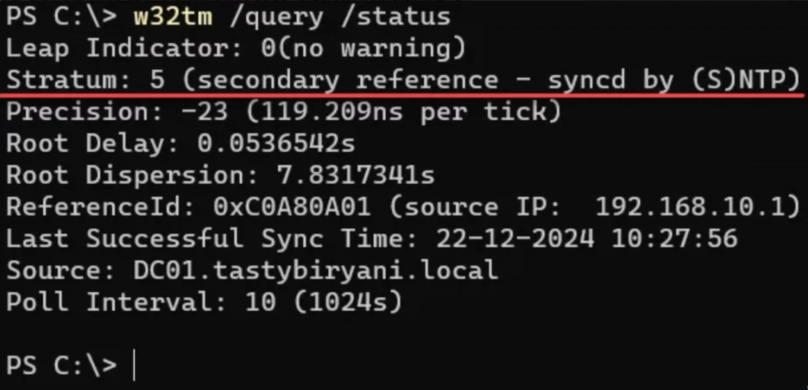

Stratum indicates how many levels separate a time server from a reference clock. A stratum 1 server gets its time directly from a reference clock, such as a GPS receiver. A stratum 2 server gets its time from a stratum 1 server.

Choose an external NTP server. I used us.pool.ntp.org from the NTP Pool Project’s [North America list](https://www.ntppool.org/zone/north-america).

Run `netdom query fsmo` to identify the domain controller holding the PDC Emulator role. In my lab, that was DC-3.

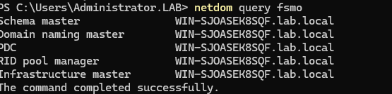

## Plan the two Group Policy Objects

Identify the two GPOs to create.

One GPO configures external time sync for DC-3. Link it to the Domain Controllers OU.

DC-4 is also in the Domain Controllers OU, so I used a WMI filter to limit this GPO to the PDC Emulator.

The other GPO configures domain time sync for computers such as my Windows 11 workstation VM (WIN11-1). I linked it at the domain level.

## Configure the external time source on DC-3

In Group Policy Management, right-click the Domain Controllers OU and select Create a GPO in this domain, and Link it here.

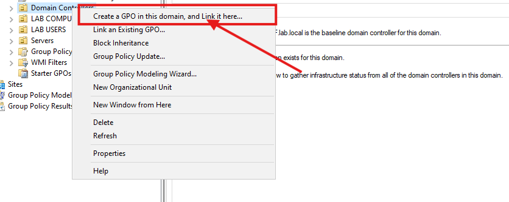

Name the GPO. I called mine Time Source for DC with PDCe.

In the left pane, go to **Computer Configuration → Policies → Administrative Templates → System → Windows Time Service → Time Providers**.

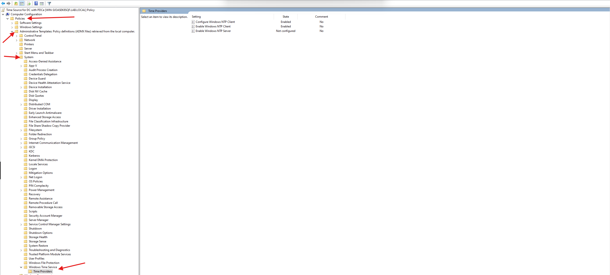

Double-click Configure Windows NTP Client and select Enabled. Set NtpServer to `us.pool.ntp.org,0x9` and Type to NTP. Click Apply, then OK.

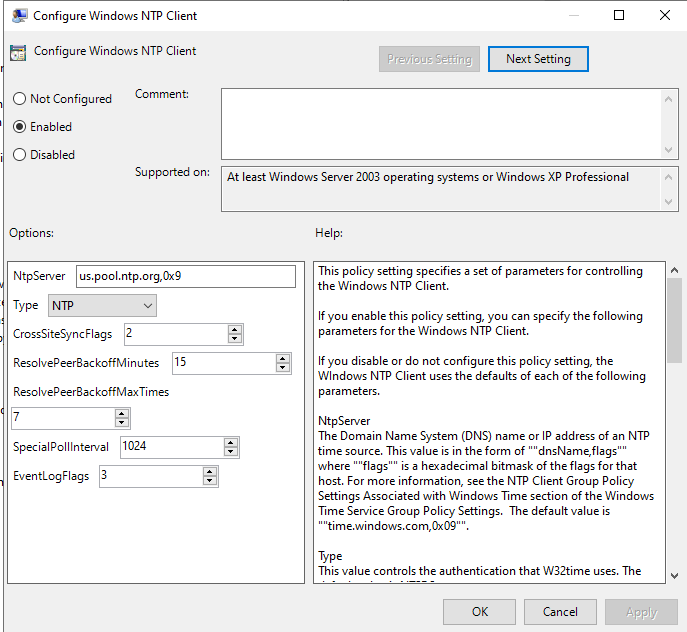

The 0x9 flag combines 0x1 (SpecialInterval) and 0x8 (Client). Together, they tell the client to poll the time server in client mode at the configured interval.

Double-click Enable Windows NTP Client and select Enabled. Click Apply, then OK.

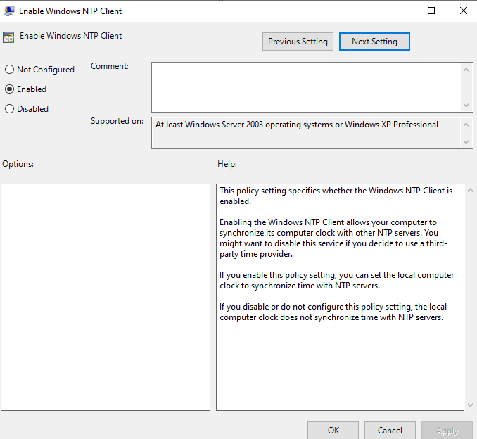

I left Enable Windows NTP Server set to Not Configured. This GPO controls how DC-3 gets its time.

## Apply the policy and verify DC-3

Run `gpupdate /force` to refresh Group Policy on DC-3.

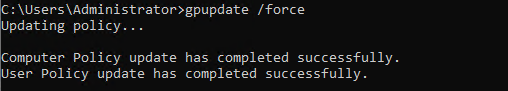

Run `net stop w32time` and then `net start w32time` to restart the Windows Time service.

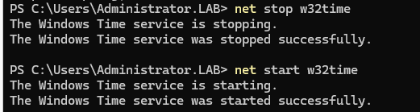

Run `w32tm /resync`, then `w32tm /query /status`. On DC-3, check that the source is us.pool.ntp.org and that the last successful sync time is recent.

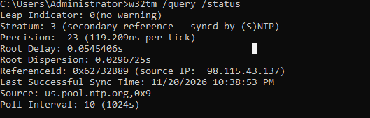

Root Delay shows the total round-trip delay to the reference clock. Root Dispersion estimates the accumulated timing uncertainty. Run `w32tm /stripchart /computer:us.pool.ntp.org` to see how the time difference between DC-3 and the external server changes across samples.

## Configure domain members to follow the domain hierarchy

Return to Group Policy Management. Under Domains, right-click the domain name (lab.local) and select Create a GPO in this domain, and Link it here.

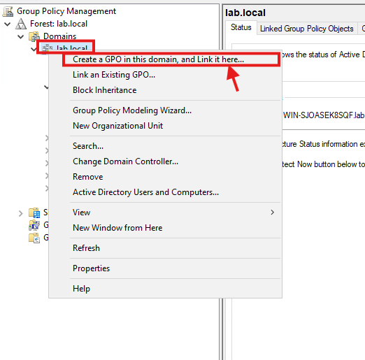

Name the GPO and go to **Computer Configuration → Policies → Administrative Templates → System → Windows Time Service → Time Providers**. Open Configure Windows NTP Client, select Enabled, and set Type to `NT5DS`. Click Apply, then OK.

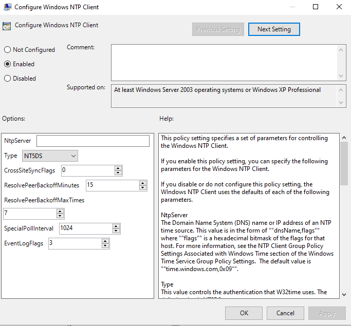

`NT5DS` follows the Active Directory time hierarchy. NTP uses the time servers specified in the client configuration.

Double-click Enable Windows NTP Client and select Enabled. Click Apply, then OK.

## Verify the Windows 11 workstation

On the domain-joined Windows 11 VM (WIN11-1), open PowerShell as an administrator and run `gpupdate /force`.

Run `net stop w32time` and then `net start w32time`.

Run `w32tm /query /source` to confirm that the workstation is getting its time from a domain controller.

## Troubleshooting DC-4

Time was still out of sync on DC-4, my other domain controller. Since both DCs were in the Domain Controllers OU, I suspected DC-4 was also picking up the external NTP settings. I applied a WMI filter to the “Time Source for DC with PDCe” GPO so that only the PDC Emulator (DC-3) would receive it. After the change, DC-4 synced with DC-3.
